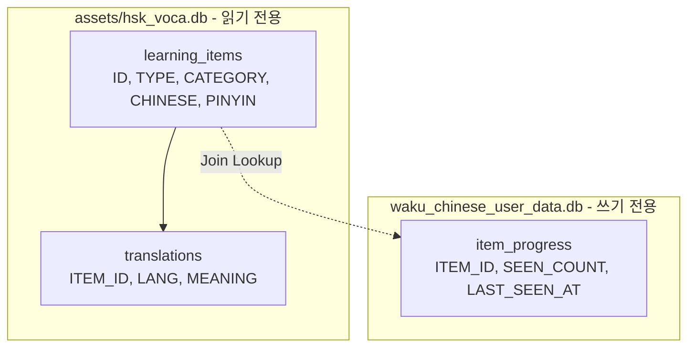
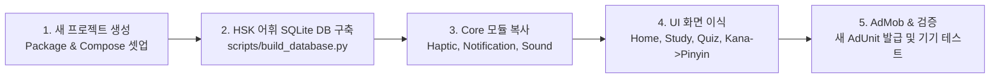

# 🇨🇳 Waku 중국어 앱 구현 및 아키텍처 가이드 (Waku Chinese)

본 문서는 **Waku 일본어**의 검증된 아키텍처와 최신 기능(Room 이원화, 다국어 확장 설계, 햅틱 피드백, AdMob 정책 준수 컴팩트 네이티브 배너, 일일 알림 등)을 기반으로 **새로운 프로젝트 폴더에서 『Waku 중국어』 앱을 완벽하게 구축하기 위한 통합 엔지니어링 가이드**입니다.

---

## 📑 목차
1. [프로젝트 기본 정보 및 브랜드 아이덴티티](#1-프로젝트-기본-정보-및-브랜드-아이덴티티)
2. [기술 스택 및 의존성 라이브러리 (libs.versions.toml)](#2-기술-스택-및-의존성-라이브러리)
3. [데이터베이스 설계 및 어휘 데이터 구조 (일본어 vs 중국어)](#3-데이터베이스-설계-및-어휘-데이터-구조)
4. [핵심 기능 모듈 이식 가이드](#4-핵심-기능-모듈-이식-가이드)
   - 4.1. [중국어 TTS 엔진 (TtsManager)](#41-중국어-tts-엔진-ttsmanager)
   - 4.2. [3단계 플래시카드 & 병음(Pinyin) UI (FlashCardView)](#42-3단계-플래시카드--병음pinyin-ui)
   - 4.3. [햅틱 피드백 관리자 (HapticManager)](#43-햅틱-피드백-관리자-hapticmanager)
   - 4.4. [4지선다 퀴즈 엔진 (QuizScreen & ViewModel)](#44-4지선다-퀴즈-엔진-quizscreen--viewmodel)
   - 4.5. [일일 학습 리마인더 (StudyNotificationManager)](#45-일일-학습-리마인더-studynotificationmanager)
   - 4.6. [구글 AdMob 컴팩트 네이티브 광고 (정책 완벽 준수)](#46-구글-admob-컴팩트-네이티브-광고-정책-완벽-준수)
5. [화면별 UX & 인터랙션 디자인 가이드 (Waku 시그니처 UX)](#5-화면별-ux--인터랙션-디자인-가이드-waku-시그니처-ux)
   - 5.1. [홈 화면 (HomeScreen) UX: 접이식 3대 옵션 & 2x2 대시보드](#51-홈-화면-homescreen-ux-접이식-3대-옵션--2x2-대시보드)
   - 5.2. [학습 화면 (StudyScreen) UX: 3단계 플래시카드 & 카테고리 기억](#52-학습-화면-studyscreen-ux-3단계-플래시카드--카테고리-기억)
   - 5.3. [퀴즈 화면 (QuizScreen) UX: 방향 전환 & 무부담 풀이 시스템](#53-퀴즈-화면-quizscreen-ux-방향-전환--무부담-풀이-시스템)
   - 5.4. [청각 & 촉각 UX 원칙 (100% 무음 + 정밀 햅틱)](#54-청각--촉각-ux-원칙-100-무음--정밀-햅틱)
6. [단계별 프로젝트 셋업 로드맵](#6-단계별-프로젝트-셋업-로드맵)

---

## 1. 프로젝트 기본 정보 및 브랜드 아이덴티티

| 구분 | Waku 일본어 (참고용) | Waku 중국어 (신규 앱 제안) |
| :--- | :--- | :--- |
| **앱 명칭 (한글)** | `Waku 일본어` | `Waku 중국어` |
| **스토어 표기명** | Waku 일본어 - JLPT 필수 단어·한자·회화 | Waku 중국어 - HSK 필수 단어·병음·회화 |
| **패키지명** | `com.bluefield.atelier.waku` | `com.bluefield.atelier.waku.chinese` (권장) |
| **앱 대표 테마 컬러** | 벚꽃 핑크 & 소프트 라벤더 (`#FF8FA3`, `#6750A4`) | 비취 에메랄드 또는 오리엔탈 버밀리온 & 웜 앰버 (`#D32F2F` or `#00897B`, `#FFB300`) |
| **학습 분류 체계** | JLPT (N5 ~ N1), 기초 회화, 여행 | HSK (HSK 1급 ~ 6급), 기초 병음/성조, 생활 회화, 비즈니스 |

---

## 2. 기술 스택 및 의존성 라이브러리

### `gradle/libs.versions.toml`
```toml
[versions]
agp = "8.8.0"
kotlin = "2.1.0"
coreKtx = "1.15.0"
lifecycleRuntimeKtx = "2.8.7"
activityCompose = "1.10.0"
composeBom = "2025.01.00"
navigationCompose = "2.8.6"
room = "2.6.1"
ksp = "2.1.0-1.0.29"
datastore = "1.1.2"
playServicesAds = "23.6.0"

[libraries]
androidx-core-ktx = { group = "androidx.core", name = "core-ktx", version.ref = "coreKtx" }
androidx-lifecycle-runtime-ktx = { group = "androidx.lifecycle", name = "lifecycle-runtime-ktx", version.ref = "lifecycleRuntimeKtx" }
androidx-activity-compose = { group = "androidx.activity", name = "activity-compose", version.ref = "activityCompose" }
androidx-compose-bom = { group = "androidx.compose", name = "compose-bom", version.ref = "composeBom" }
androidx-ui = { group = "androidx.compose.ui", name = "ui" }
androidx-ui-graphics = { group = "androidx.compose.ui", name = "ui-graphics" }
androidx-ui-tooling-preview = { group = "androidx.compose.ui", name = "ui-tooling-preview" }
androidx-material3 = { group = "androidx.compose.material3", name = "material3" }
androidx-material-icons-extended = { group = "androidx.compose.material", name = "material-icons-extended" }
androidx-navigation-compose = { group = "androidx.navigation", name = "navigation-compose", version.ref = "navigationCompose" }
androidx-datastore-preferences = { group = "androidx.datastore", name = "datastore-preferences", version.ref = "datastore" }
androidx-room-runtime = { group = "androidx.room", name = "room-runtime", version.ref = "room" }
androidx-room-ktx = { group = "androidx.room", name = "room-ktx", version.ref = "room" }
androidx-room-compiler = { group = "androidx.room", name = "room-compiler", version.ref = "room" }
play-services-ads = { group = "com.google.android.gms", name = "play-services-ads", version.ref = "playServicesAds" }
```

---

## 3. 데이터베이스 설계 및 어휘 데이터 구조

Waku 시리즈는 **사전 DB(Read-Only Asset)**와 **사용자 학습 기록 DB(Writable User)**를 분리하는 **이원화 DB 아키텍처**를 채택합니다.



### 3.1. 중국어 사전 스키마 (`hsk_voca.db`)

일본어의 `reading (후리가나)` 대신 중국어는 **`pinyin (한어병음 성조 표기)`**을 사용합니다.

```sql
-- 1. 학습 아이템 테이블 (단어/문장)
CREATE TABLE learning_items (
    id INTEGER PRIMARY KEY AUTOINCREMENT,
    type TEXT NOT NULL,         -- 'WORD' (단어) 또는 'SENTENCE' (예문/회화)
    category TEXT NOT NULL,     -- 'HSK1', 'HSK2', 'HSK3', 'HSK4', 'HSK5', 'HSK6', 'CONVERSATION'
    chinese TEXT NOT NULL,      -- 간체자 표기 (예: '你好', '学习')
    pinyin TEXT NOT NULL,       -- 성조 부호 포함 병음 (예: 'nǐ hǎo', 'xuéxí')
    traditional TEXT,           -- 번체자 표기 (선택: '你好', '學習')
    level INTEGER DEFAULT 1     -- 정렬 및 난이도 순서
);

-- 2. 다국어 번역 테이블 (한국어/영어/베트남어/미얀마어 확장 대응)
CREATE TABLE translations (
    id INTEGER PRIMARY KEY AUTOINCREMENT,
    item_id INTEGER NOT NULL,
    lang TEXT NOT NULL,         -- 'ko', 'en', 'vi', 'my'
    meaning TEXT NOT NULL,      -- 번역 뜻 (예: '안녕하세요', 'Hello', 'Xin chào', 'မင်္ဂလာပါ')
    FOREIGN KEY(item_id) REFERENCES learning_items(id) ON DELETE CASCADE
);

CREATE INDEX idx_learning_items_cat ON learning_items(type, category);
CREATE INDEX idx_translations_lookup ON translations(item_id, lang);
```

### 3.2. 사용자 학습 기록 DB (`UserDatabase.kt`)
- 파일명: `waku_chinese_user_data.db`
- 사전 DB가 업데이트되어도 사용자의 암기 상태 및 출현 횟수(`seenCount`)가 유실되지 않음.
- 카드를 처음 볼 때는 뱃지 없음, 2번째부터 좌측 상단에 `🌱 N회 출현` 뱃지 노출.

---

## 4. 핵심 기능 모듈 이식 가이드

### 4.1. 중국어 TTS 엔진 (`TtsManager.kt`)
- 일본어 `Locale.JAPANESE`를 **`Locale.SIMPLIFIED_CHINESE` (또는 `Locale.CHINA`)**로 변경합니다.
- 예문 및 단어 재생 시 중국어 표준어(보통화/Putonghua)로 발음됩니다.

```kotlin
// TtsManager.kt 주요 변경
private fun initTts() {
    tts = TextToSpeech(context) { status ->
        if (status == TextToSpeech.SUCCESS) {
            val result = tts?.setLanguage(Locale.SIMPLIFIED_CHINESE)
            if (result == TextToSpeech.LANG_MISSING_DATA || result == TextToSpeech.LANG_NOT_SUPPORTED) {
                Log.w("TtsManager", "Chinese TTS data missing or not supported")
            }
        }
    }
}

fun speakChinese(text: String) {
    if (!isInitialized) return
    tts?.language = Locale.SIMPLIFIED_CHINESE
    tts?.speak(text, TextToSpeech.QUEUE_FLUSH, null, "CHINESE_TTS")
}
```

---

### 4.2. 3단계 플래시카드 & 병음(Pinyin) UI (`FlashCardView.kt`)
플래시카드는 3단계 공개 방식을 유지합니다:
1. **1단계 (원문 카드)**: 중국어 간체자 한자 표기 (예: `谢谢`)
   - 좌측 상단: `🌱 N회 출현` 뱃지 (`previousAppearanceCount > 0`일 때만)
2. **2단계 (의미 카드)**: 한국어/현지어 번역 (`고맙습니다, 감사합니다`)
3. **3단계 (발음 카드)**: 한어병음 표기 (`xièxie`) + TTS 발음 듣기

> 💡 **중국어 카드 디자인 팁**: 병음(Pinyin)은 성조(Tone 1~4)가 시각적으로 중요하므로 폰트 크기를 22~26sp 정도로 넉넉하게 잡고 가독성이 뛰어난 산세리프 폰트를 적용합니다.

---

### 4.3. 햅틱 피드백 관리자 (`HapticManager.kt`)
효과음(SFX)을 완전히 배제하고 독서실, 대중교통 등 무음 환경에서도 고급스러운 손끝 피드백을 제공합니다.
- `tap()`: 카드 넘김, 의미/발음 공개 탭 시 **초경량 12ms 틱 진동** (`EFFECT_TICK`)
- `correct()`: 퀴즈 정답 시 **경쾌한 원터치 진동** (`EFFECT_CLICK`)
- `wrong()`: 퀴즈 오답 시 **짧은 더블 탭 진동** (`톡-톡`)
- `AndroidManifest.xml`에 `<uses-permission android:name="android.permission.VIBRATE" />` 추가.

---

### 4.4. 4지선다 퀴즈 엔진 (`QuizScreen.kt` & `QuizViewModel.kt`)
- **문제 방향 전환 기능**:
  - `중국어 -> 한국어 의미 맞추기` (한자 보고 뜻 고르기)
  - `한국어 의미 -> 중국어 맞추기` (뜻 보고 올바른 한자 및 병음 고르기)
- **부담 없는 학습형 퀴즈 (점수 시스템 배제)**:
  - 사용자에게 부담을 주는 점수 계산, 감점, 마일스톤 점수판을 전면 배제.
  - 상단에는 오직 `문제 N / 전체 문제수` 진행도만 표시되어 편안하게 완주할 수 있도록 유도.
- **카테고리 필터**: HSK 1급 ~ 6급 및 전체 탭 지원.

---

### 4.5. 일일 학습 리마인더 (`StudyNotificationManager.kt`)
- `AlarmManager`를 사용해 Doze 모드(절전)에서도 정확한 시각에 알람 트리거.
- 알림 채널: `waku_chinese_study_reminder` (이름: `Waku 중국어 학습 알림`)
- 시간대 4개 슬롯:
  - 🌅 **아침** (08:30)
  - 🍱 **점심** (12:30)
  - 🌆 **저녁** (20:00)
  - 🌙 **밤** (22:00)
- 재부팅 시 알람 자동 복구를 위해 `BootReceiver` 등록 (`RECEIVE_BOOT_COMPLETED`).

---

### 4.6. 구글 AdMob 컴팩트 네이티브 광고 (정책 완벽 준수)
- **높이 50~60dp의 컴팩트 배너 구조**:
  - 앱 아이콘 (`38dp`) + `AD` 뱃지 + 헤드라인 + 본문 + `확인` 버튼 + `AdChoicesView`
- **AdChoices 필수 배치**:
  - 레이아웃 최우측 상단에 겹침 없이 배치 (`layout_compact_native_ad.xml`)
- **동영상 광고 방어 (중요 ⚠️)**:
  - 애드몹 콘솔에서 미디어 유형 **'동영상' 체크 해제** (이미지만 사용)
  - 코드 방어: `NativeAdOptions.Builder().setVideoOptions(VideoOptions.Builder().setStartMuted(true).build())` 적용
- **테스트 디버거 팝업 억제**:
  - `AndroidManifest.xml`에 `<meta-data android:name="com.google.android.gms.ads.flag.NATIVE_AD_DEBUGGER_ENABLED" android:value="false" />` 추가.

---

---

## 5. 화면별 UX & 인터랙션 디자인 가이드 (Waku 시그니처 UX)

Waku 시리즈는 **"군더더기 없는 미니멀리즘과 몰입감 높은 손끝 인터랙션"**을 핵심 철학으로 합니다. Waku 중국어에서도 아래 4가지 화면별 UX 규칙을 완벽하게 재현해야 합니다.

### 5.1. 홈 화면 (HomeScreen) UX: 접이식 3대 옵션 & 2x2 대시보드

```
┌──────────────────────────────────────────────┐
│  Waku 중국어 🎋                              │
│  두근두근 설레는 중국어 공부 ✨     [🔤 성조표]│
├──────────────────────────────────────────────┤
│ ┌──────────────────────────────────────────┐ │
│ │ ⚙️ 학습 옵션 설정            [ 접기/펼치기 ] │ │
│ │ ──────────────────────────────────────── │ │
│ │ [접힘 상태 요약 뱃지]                    │ │
│ │  [ TTS · 자동 · 알림 ]                   │ │
│ │                                          │ │
│ │ [펼침 상태 컨트롤 - 필수 3대 옵션]        │ │
│ │  - 🔊 발음 자동 읽기 (TTS)    [ Switch ]  │ │
│ │  - ⚡ 자동 넘김               [ Switch ]  │ │
│ │    (3초 / 4초 / 5초 맞춤 선택 칩)        │ │
│ │  - 🔔 매일 복습 알림          [ Switch ]  │ │
│ │    (아침 08:30 / 점심 12:30 / 저녁 / 밤)  │ │
│ └──────────────────────────────────────────┘ │
│                                              │
│ ┌──────────────────────┐ ┌─────────────────┐ │
│ │ 📖 HSK 단어 학습     │ │ 💬 일상 회화    │ │
│ │ 필수 어휘 카드 암기  │ │ 실전 문장 학습  │ │
│ └──────────────────────┘ └─────────────────┘ │
│ ┌──────────────────────┐ ┌─────────────────┐ │
│ │ 🎯 4지선다 단어 퀴즈 │ │ 🧩 회화 퀴즈    │ │
│ │ 실력 점검 테스트     │ │ 문장 완성 테스트│ │
│ └──────────────────────┘ └─────────────────┘ │
└──────────────────────────────────────────────┘
```

1. **접이식(Collapsible) 3대 필수 옵션 카드**:
   - 불필요한 기능(수면 모드 등)을 완전히 배제하고, 학습자가 실제로 자주 쓰는 **핵심 3대 옵션(TTS, 자동 넘김, 학습 알림)**만 집약했습니다.
   - **접힘 상태 요약**: 켜져 있는 기능만 깔끔한 캡슐 뱃지로 요약 (예: `TTS · 자동 · 알림`, 모두 껐을 땐 `모두 끔`). 알림은 구구절절 시간 없이 심플하게 `알림`으로만 축약 표시합니다.
   - **펼침 상태**: TTS 스위치, 자동 넘김 시간 조절 칩, 일일 4개 시간대 알림 슬롯을 빠르게 조작할 수 있습니다.
2. **2x2 모드 대시보드**:
   - `단어 학습`, `회화 학습`, `단어 퀴즈`, `회화 퀴즈` 4개의 카드가 넉넉한 터치 영역과 부드러운 엘리베이션(그림자)으로 배치됩니다.

---

### 5.2. 학습 화면 (StudyScreen) UX: 3단계 플래시카드 & 카테고리 기억

```
┌──────────────────────────────────────────────┐
│  ← Waku 중국어                     [🔤 성조표]│
├──────────────────────────────────────────────┤
│  [전체] [HSK 1급] [★ HSK 2급] [HSK 3급] ...  │  <- 카테고리 칩 바
├──────────────────────────────────────────────┤
│  [Compact Native Ad Banner - 50dp]           │
├──────────────────────────────────────────────┤
│ ┌──────────────────────────────────────────┐ │
│ │ 🌱 2회 출현                               │ │
│ │                                          │ │
│ │                  谢谢                    │ │  <- 1단계: 간체자 한자
│ │                                          │ │
│ └──────────────────────────────────────────┘ │
│ ┌──────────────────────────────────────────┐ │
│ │ 💡 고맙습니다, 감사합니다                 │ │  <- 2단계: 한국어 의미
│ └──────────────────────────────────────────┘ │
│ ┌──────────────────────────────────────────┐ │
│ │ 🔊 xièxie  (제4성 + 경성)                │ │  <- 3단계: 한어병음/성조
│ └──────────────────────────────────────────┘ │
├──────────────────────────────────────────────┤
│    [ ◀ 이전 ]   [ 🔊 발음 ]   [ ▶ 자동 ]   [ 다음 ▶ ]│  <- 하단 컨트롤 바
└──────────────────────────────────────────────┘
```

1. **카테고리 최근 선택 자동 기억 (Last Category Memory)**:
   - 사용자가 `HSK 2급`을 공부하다가 앱을 끄거나 홈으로 나가도, 다시 단어 학습에 들어오면 **방금 공부하던 `HSK 2급`이 기본 선택**되어 즉시 학습을 이어갈 수 있습니다 (`SettingsRepository` 연동).
2. **3단계 순차 공개 인터랙션**:
   - **1단계 (원문 카드)**: 중국어 간체자만 큼직하게 노출. 화면 어디든 탭하면 2단계가 열립니다.
   - **2단계 (의미 카드)**: 한국어 뜻이 부드러운 페이드인으로 등장. 다시 탭하면 3단계가 열립니다.
   - **3단계 (병음/발음 카드)**: 한어병음(xièxie)이 공개되고 중국어 TTS가 발음됩니다. 이 상태에서 탭하면 다음 카드로 넘어갑니다.
   - **개별 탭 직접 점프 UX**: 하단의 `💡 의미 확인` 또는 `🔊 발음 확인` 카드를 직접 탭하면 순서를 건너뛰고 해당 정보가 바로 즉시 열립니다.
3. **누적 출현 횟수 배지 (`🌱 N회 출현`)**:
   - **첫 조우 시**: 배지가 아예 노출되지 않아 깨끗한 첫인상을 줍니다 (`count == 0`).
   - **2번째 이상 조우 시**: 좌측 상단에 `🌱 1회 출현`, `🌱 2회 출현` 등 직전까지 공부했던 횟수가 배지로 노출되어 복습 성취감을 부여합니다.
4. **하단 컨트롤 바 & 제스처**:
   - 이전 / TTS 발음 재생 / 자동 넘김 토글(Pause/Play) / 다음 카드 버튼 배치.
   - 좌우 스와이프 제스처를 지원하여 한 손 조작성을 극대화합니다.

---

### 5.3. 퀴즈 화면 (QuizScreen) UX: 방향 전환 & 무부담 풀이 시스템

```
┌──────────────────────────────────────────────┐
│  ← HSK 단어 퀴즈               [ 🔄 방향전환 ]│
├──────────────────────────────────────────────┤
│  문제 3 / 50                                 │  <- 순수 진행도만 깔끔하게 노출
├──────────────────────────────────────────────┤
│ ┌──────────────────────────────────────────┐ │
│ │                   苹果                   │ │  <- 문제 카드
│ │             🔊 탭하여 발음 듣기          │ │
│ └──────────────────────────────────────────┘ │
│                                              │
│ ┌──────────────────────────────────────────┐ │
│ │ ① 바나나                     (오답 표시)│ │  <- 탭 시 빨간 테두리 + 진동
│ └──────────────────────────────────────────┘ │
│ ┌──────────────────────────────────────────┐ │
│ │ ② 사과                       (정답 선택)│ │  <- 탭 시 초록 배경 + 산뜻한 진동
│ └──────────────────────────────────────────┘ │
│ ┌──────────────────────────────────────────┐ │
│ │ ③ 수박                                  │ │
│ └──────────────────────────────────────────┘ │
│ ┌──────────────────────────────────────────┐ │
│ │ ④ 포도                                  │ │
│ └──────────────────────────────────────────┘ │
└──────────────────────────────────────────────┘
```

1. **양방향 퀴즈 전환 버튼 (🔄)**:
   - 상단 우측 버튼 하나로 **`[중국어 한자 보고 뜻 맞추기]`** 모드와 **`[한국어 뜻 보고 중국어/병음 맞추기]`** 모드를 실시간으로 언제든 바꿀 수 있습니다.
2. **점수 스트레스 없는 학습형 퀴즈**:
   - 점수 카운터, 감점, 점수 마일스톤 등의 불필요한 게이미피케이션 요소를 배제하고, 상단에 **`문제 N / 전체 문제수` 진행률만 심플하게 표시**하여 부담 없이 어휘 점검에 집중할 수 있습니다.
3. **즉각적이고 관대한 오답 피드백 UX**:
   - 오답을 눌렀을 때: 해당 보기가 빨간 테두리로 바뀌며 **더블 탭 햅틱 피드백**이 발생하지만, 바로 실패 처리하지 않고 **다른 보기를 다시 고를 수 있는 기회**를 줍니다.
   - 정답을 눌렀을 때: 초록색 하이라이트 + 산뜻한 탭 진동과 함께 약 1.2초 후 다음 문제로 자동 매끄럽게 넘어갑니다.

---

### 5.4. 청각 & 촉각 UX 원칙 (무음 + 정밀 햅틱)

1. **인위적인 효과음 배제 (100% 무음 정책)**:
   - 앱 내에서 인위적인 비프음이나 삑삑거리는 사운드 효과음을 일체 재생하지 않습니다.
   - `MainActivity`에서 `window.decorView.isSoundEffectsEnabled = false`를 적용하여 기기 자체의 시스템 터치 클릭음조차 차단합니다 (독서실, 지하철, 야간 침실 최적화).
2. **손끝으로 전해지는 정밀 햅틱 (`HapticManager`)**:
   - 소리가 없는 대신 모든 주요 조작에 **초경량 12ms 틱 햅틱**을 적용하여 "누르는 맛"을 살립니다.
   - **자동 넘김 배려**: 사용자가 직접 화면을 터치할 때만 햅틱이 작동하며, **자동 넘김 모드 중에는 진동이 연속으로 울리지 않도록** 처리합니다 (`fromUser = false`).

---

## 6. 단계별 프로젝트 셋업 로드맵



### Step 1. 새 안드로이드 프로젝트 생성
1. 패키지명: `com.bluefield.atelier.waku.chinese` (또는 원하시는 식별자)
2. `strings.xml`:
   ```xml
   <resources>
       <string name="app_name">Waku 중국어</string>
   </resources>
   ```

### Step 2. HSK 단어 DB 준비
1. CSV 또는 JSON 데이터 구조: `type, category, chinese, pinyin, meaning_ko, meaning_en, meaning_vi, meaning_my`
2. 파이썬 스크립트로 `assets/hsk_voca.db` 생성 (SQLite 빌드).

### Step 3. 50음도표 대안: 한어병음 자모표 (Pinyin Chart)
- Waku 일본어의 **"50음도표 다이얼로그"** 위치에 중국어의 **"성모(Initials, 23개) / 운모(Finals, 24개) / 4성 성조표 다이얼로그"**를 넣어주면 완성도가 극대화됩니다!

---

이 가이드를 바탕으로 새 프로젝트 폴더에서 동일한 아키텍처와 시그니처 UX로 손쉽게 『Waku 중국어』 앱을 확장하실 수 있습니다! 🚀

